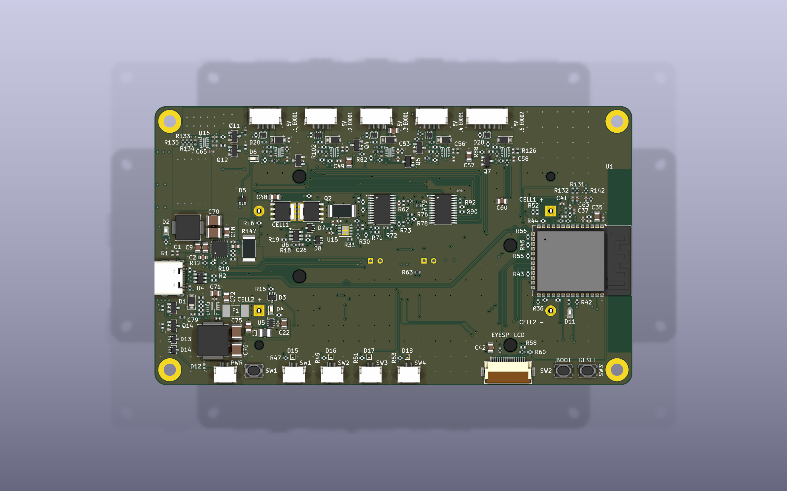
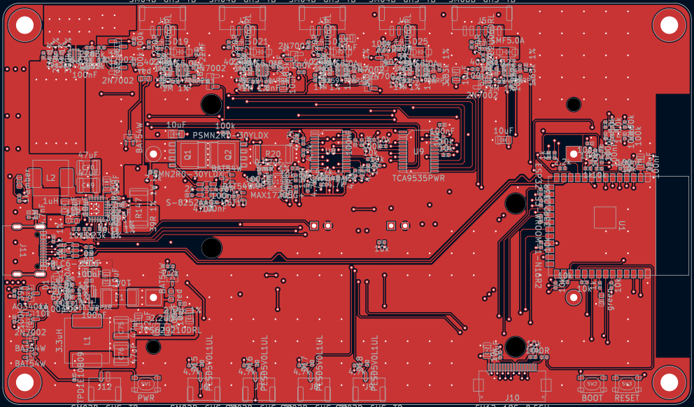
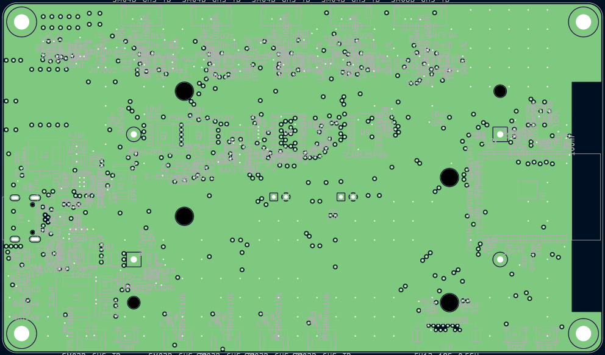
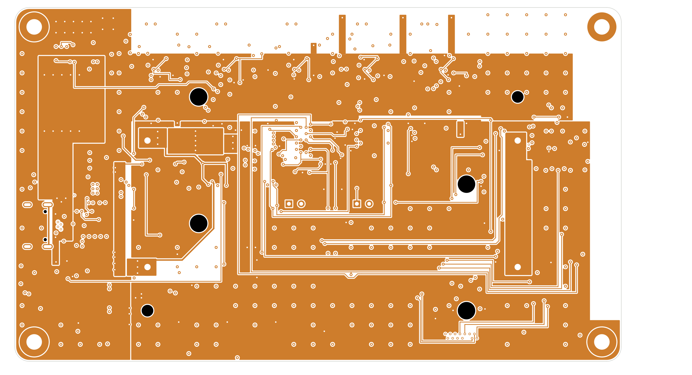
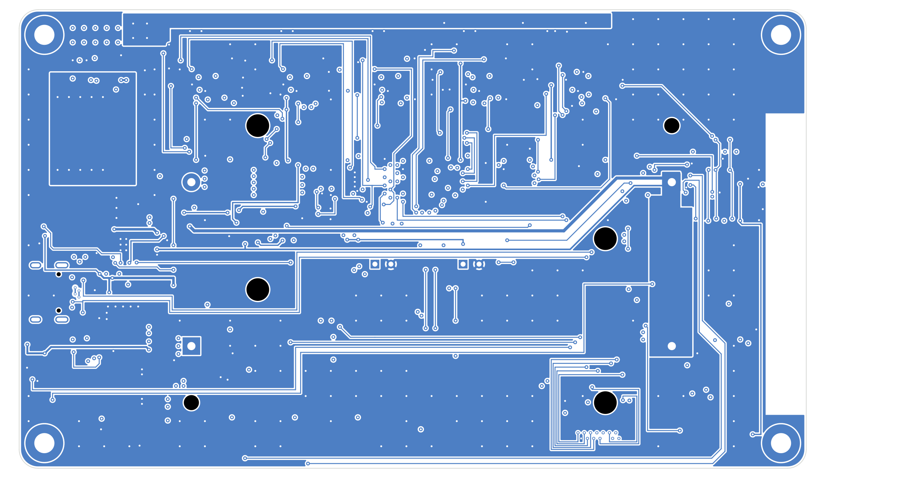
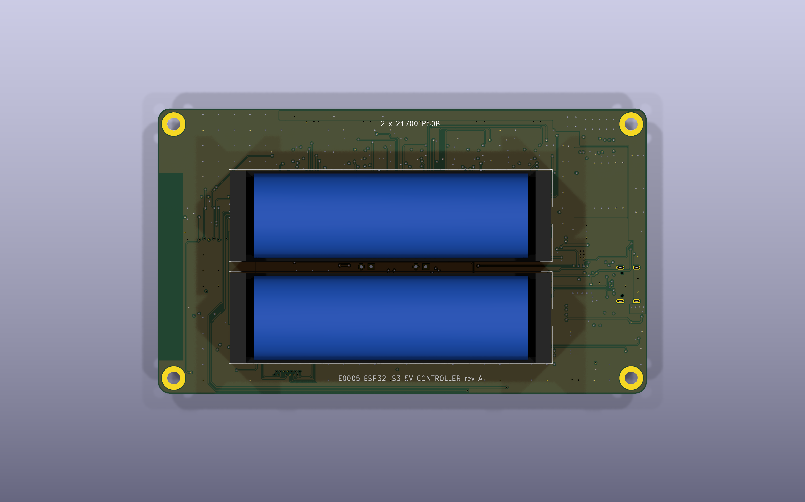
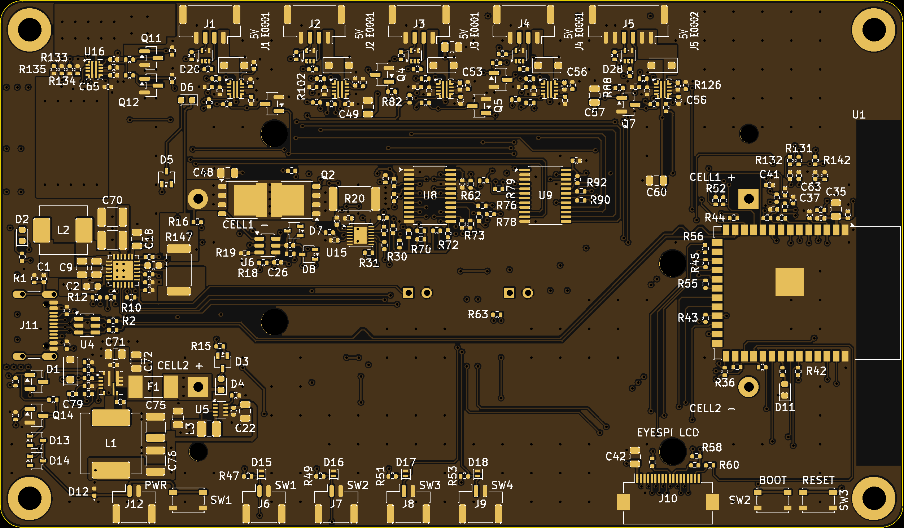

# E0005: ESP32-S3 5 V controller board

The 5 V version of the E0003 control-box mainboard. An **ESP32-S3** runs the box from a **2S1P 21700 pack** (Molicel P50B, holders on the bottom side), or from **plain 5 V USB-C (no PD)** with no cells fitted. One protected **5 V system rail (V5)** feeds the 3V3 regulator and five **+5 V peripheral ports**:
- 4 × fader driver (E0001 pinout);
- 1 × haptic knob (E0002 pinout).

Each port has its own eFuse and an I²C channel through a mux. The board also drives an **EYESPI SPI LCD** and reads **4 switch inputs**.

The current E0001 rev C and E0002 rev B need 6–9 V. They **will not run** on E0005: 5 V revisions are needed (SPEC §6 is their host-interface spec).

*Top side (KiCad 3D render):*
- *USB-C J11, the U_IN eFuse, the BQ25887 charger and the TPS56637 buck on the west side;*
- *the five JST-GH ports with their eFuses along the north edge;*
- *the ESP32-S3 module with its antenna keep-out at the east edge;*
- *switch inputs, power button, EYESPI and BOOT/RESET on the south edge.*

## Key specs
| | |
|---|---|
| Board | **Rev A**, 125 × 73 mm, R3 corners, 4 × M3 (Ø3.2 mm plated, 4 mm inset) |
| PCB | **4 layers, 1.6 mm**, 1 oz outer / 0.5 oz inner, JLC impedance stackup **JLC04161H-3313**. USB pair 90 Ω differential (W 0.153 / S 0.20 mm, coplanar, L1 over In1 GND) |
| Layers | **F.Cu**: parts, signals, power pours · **In1**: solid GND · **In2**: V5 plane (west column + port band), 3V3 plane, short slow lanes · **B.Cu**: signals, GND pour, holder lugs, V5 strap |
| MCU | **ESP32-S3-WROOM-1-N16R2** (16 MB flash, 2 MB PSRAM, Wi-Fi/BLE, PCB antenna) |
| Battery | **2 × Molicel P50B 21700 in series** (2S1P, ≈ 36 Wh), 2 × Keystone 1121 holders on the bottom |
| USB | **USB-C, 5 V only, no PD:** 2 × 5.1 kΩ Rd, CC1/CC2 to the ESP32 ADC to read the source's Rp level. Native USB for flashing, CDC and JTAG |
| Charger | **TI BQ25887** 2 A boost charger (5 V → 2S), I²C, 16-bit ADC, integrated cell balancing |
| 5 V rail (V5) | Diode-OR by voltage: **USB through a TPS259470A eFuse** (0.50 / 1.37 / 2.81 A limit, chosen by firmware) **or** the **TPS56637 6 A buck** from the pack (4.80 V). Copper is sized for 4.6 A at ΔT ≤ 20 °C |
| Ports | **6 × TPS259470A** eFuses in total: U_IN plus one per port J1–J5 (OVLO 6.0 V, UVLO 3.8 V, reverse blocking, auto-retry) |
| Status | DRC 0 errors / 0 unconnected / 0 parity (U1 library exception only), ERC 0. Fab outputs in `fab/E0005_revA/`. See "Status and open items" |

## Features and interfaces
| Function | Implementation |
|---|---|
| USB-C (J11) | ESP32-S3 native USB (flashing, CDC console, JTAG) and the charging input. Runs the whole system with no battery fitted. SMF9.0A TVS on VBUS, USBLC6 ESD on the data lines |
| Power path | **U_IN** (TPS259470A) feeds V5 from VBUS. Its limit is 0.50 A at reset, and 1.37 A or 2.81 A when firmware selects it from the CC level. When the load exceeds the USB limit, the **TPS56637** buck makes up the difference from the battery. U_IN blocks reverse current, so the buck never back-feeds the USB host |
| Charger | **BQ25887** 5 V → 2S boost charger, 2 A, balancing ≈ 110 mA, cell OVP, JEITA (NTCs RT1/RT2) |
| Battery management | **MAX17205** fuel gauge (5 mΩ sense, Kelvin) · **S-8252** 2S protector with 2 × PSMN2R0-30YLDX · **10 A fuse F1** · per-cell voltages from the BQ25887 ADC |
| 3V3 rail | TPS629210 1 A buck from V5, so a port fault never resets the MCU |
| Ports J1–J4 | 4 × E0001-pinout ports, JST-GH 4-pin (1 +5V, 2 SCL, 3 SDA, 4 GND), eFuse 0.74–1.00 A, SMF5.0A TVS |
| Port J5 | 1 × E0002-pinout port, JST-GH 6-pin (1–2 +5V, 3 SCL, 4 SDA, 5–6 GND), eFuse 1.80–2.20 A |
| I²C | **I2C0** on-board: BQ25887, MAX17205, TCA9535 expander. **I2C1**: PCA9548A mux, one channel per port, 3.3 V pull-ups, ESD and series resistors |
| LCD (J10) | 18-pin 0.5 mm **EYESPI** FPC for the Adafruit 2.0" 320×240 IPS (PID 4311) |
| Switch inputs (J6–J9) | 4 × JST-GH 2-pin, pull-up + RC + ESD, wake from deep sleep |
| Buttons | Power button (on board, plus JST-GH J12 for a panel button) with a **soft power latch on the buck EN** ("off" ≈ 35 µA); BOOT, RESET |
| Silkscreen | **"5V Jn E0001"** / **"5V J5 E0002"** at each port |
| Test points | None (owner rule). Bring-up is via USB and component pads |

## Power architecture
- **USB only:** V5 = VBUS through U_IN, at 4.9–5.1 V. The buck is off.
- **Battery only:** V5 = TPS56637 output, 4.80 V. Firmware sheds the ports below a 6.4 V pack.
- **USB + battery:** USB holds V5 above the buck set point, so the buck is idle. When the load exceeds U_IN's limit, U_IN regulates its current and the buck carries the rest. The charger charges the pack from VBUS at the same time; firmware keeps U_IN + charger input within the source's Rp budget.
- Load budget:
  - worst plausible V5 load 4.85 A;
  - firmware port budget 4.4 A;
  - TPS56637 rated 6 A, with a 6.3–8.6 A valley limit.
- Details: [`docs/SPEC.md`](docs/SPEC.md) §5.

## Copper layers
All four layers are seen from the top, with the board outline (KiCad plots).

| | |
|---|---|
|  *F.Cu: parts, signals, power pours* |  *In1.Cu: solid GND reference plane* |
|  *In2.Cu: V5 plane (west column, port band), 3V3 plane* |  *B.Cu: signals, GND pour, holder lugs, V5 strap* |

## More views
| | |
|---|---|
|  *Bottom side: the two Keystone 1121 holders* |  *Top mask and silk, rendered from the gerbers* |

## Repository layout
| Path | Content |
|---|---|
| `E0005_controller.kicad_pro` / `.kicad_pcb` / `.kicad_sch` | KiCad project, board and root schematic |
| `power.kicad_sch`, `battery.kicad_sch`, `mcu.kicad_sch`, `ports.kicad_sch` | Schematic sheets: USB-C, U_IN, charger, buck and 3V3 · battery pack, protection and gauge · ESP32-S3, LCD, switches, buttons · peripheral ports |
| `E0005_controller.kicad_dru` | JLC design rules, the no-via-on-pad rule, and the routing pour/USB rules |
| `docs/SPEC.md` | Requirements and architecture spec (v1.4, frozen) |
| `docs/schematic_notes.md`, `docs/placement_notes.md`, `docs/routing_notes.md` | Capture notes (deviations, V5 capacitance, back-feed), placement notes, routing notes (widths, IPC-2152 table, USB, hot loops) |
| `docs/images/` | Board and 3D renders used here |
| `bom/` | DigiKey BOM (`E0005_digikey_bom.csv`, generated), new-part lookups, sourcing notes |
| `lib/` | Project symbols and footprints (`E0005.*`), the board outline and holes (`E0005_board`), and mechanical parts with 3D models (`E0005_mech.*`) |
| `build/scripts/` | Generators and checks. **`fab_export.sh`** builds the fab package; **`gerber_review.py`** renders and measures the gerbers; `make_bom.py` builds the BOM |
| `build/route/` | Hand-routing scripts (sent over KiCad IPC; no autorouter) |
| `fab/E0005_revA/` | **Fabrication package:** `E0005_revA_gerbers_JLC.zip` (upload to JLC), gerbers, drill, placement, assembly PDFs, BOM, STEP, DRC/ERC reports, gerber review, [README](fab/E0005_revA/README.md) with the order settings, and [PREORDER.md](fab/E0005_revA/PREORDER.md) |

## Status and open items
- **Rev A fab outputs are generated:** DRC 0 / 0 / 0 (U1 `lib_footprint_mismatch` accepted), ERC 0. JLC order settings (JLC04161H-3313 with impedance control, tented vias, ENIG) are in [`fab/E0005_revA/README.md`](fab/E0005_revA/README.md).
- **Before ordering** ([`PREORDER.md`](fab/E0005_revA/PREORDER.md)):
  - Decide the two gerber-review findings: **F-1**, the V5 via in L1 pad 2; **F-2**, the FET_D vias at Q2's drain-tab edge.
  - Test-fit the flat-top P50B in the Keystone 1121.
  - Confirm the DigiKey cut-tape PNs for BQ25887RGER and TPS56637RPAR.
  - Order the LCSC / Adafruit / nkon parts.
- **Bench checks at bring-up:**
  - O-1: TPS56637 load step (FF C79 100 → 220 pF if it rings);
  - O-2b: TPS56637 temperature with the SW discharge active (USB only, no battery);
  - O-4: USB-unplug V5 dip at full load, and U_IN temperature in current limit.
- **Sister boards:** E0001 and E0002 need 5 V revisions to work on this board (out of scope here).
